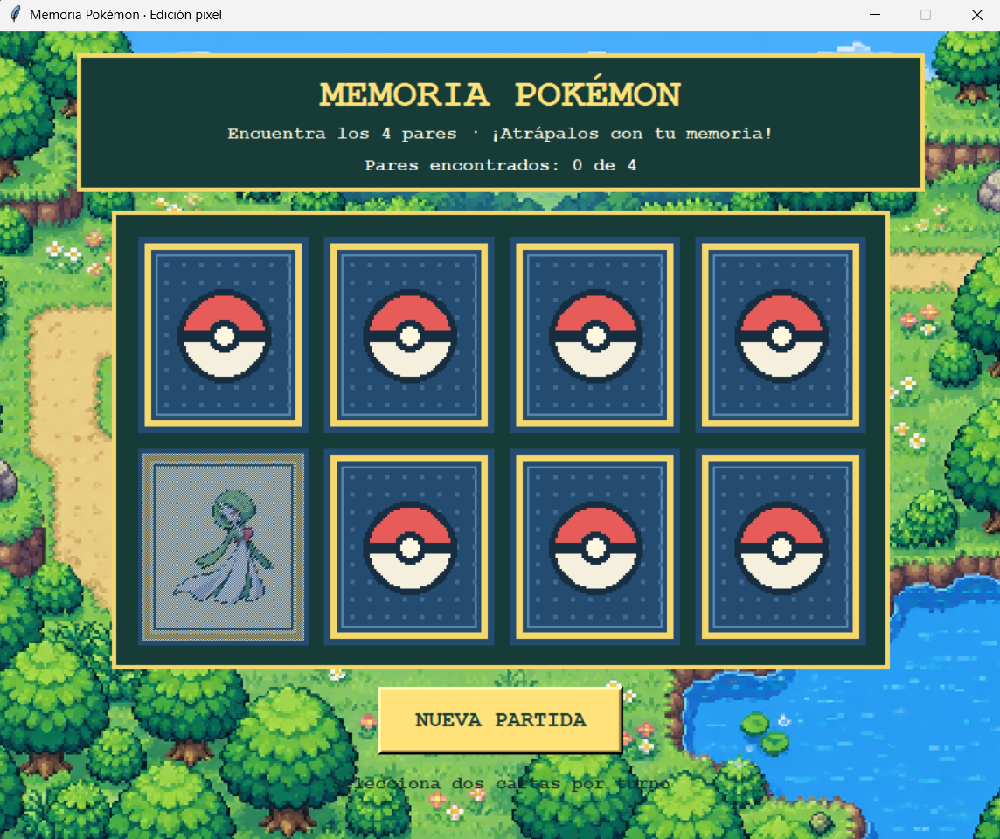

## Segunda iteración - Versión 2.0

### Prompt utilizado

**Contexto:**

Eres un asistente experto en desarrollo de videojuegos utilizando Python y Tkinter.

Actualmente tenemos desarrollada la primera versión de un juego de memoria ubicado en `C:\Game`, cuyo archivo principal es `main.py`.

El juego ya cuenta con un tablero de cuatro pares de cartas, un contador de pares encontrados y un botón para iniciar una nueva partida.

Necesito que trabajes sobre el código existente, conservando su funcionamiento y mejorando únicamente su presentación visual.

**Instrucción:**

Quiero desarrollar la segunda versión del juego de memoria, incorporando una temática inspirada en los videojuegos clásicos de Pokémon, utilizando sprites en pixel art.

Realiza las siguientes modificaciones:

1. Sustituye los símbolos actuales de las cartas por imágenes de cuatro Pokémon diferentes: Gardevoir, Gengar, Pikachu y Lucario.
2. Cada Pokémon deberá aparecer dos veces, formando los cuatro pares del juego.
3. Cuando las cartas estén boca abajo, deberán mostrar un diseño uniforme inspirado en las cartas Pokémon, preferiblemente con una Poké Ball en el centro.
4. Al seleccionar una carta, deberá mostrarse el sprite del Pokémon correspondiente.
5. Agrega un fondo visual inspirado en los escenarios clásicos de Pokémon, utilizando una estética pixel art.
6. Mejora el diseño de los botones, títulos y contador de pares encontrados para que combinen con la temática del juego.
7. Mantén las cartas organizadas en una cuadrícula de cuatro columnas y dos filas.
8. Conserva la funcionalidad de reiniciar la partida y distribuir aleatoriamente las cartas.
9. Cuando el jugador encuentre los cuatro pares, muestra un mensaje de victoria acorde con la temática.

**Formato de salida:**

- Utiliza Python y conserva Tkinter como biblioteca principal.
- Modifica el archivo existente `C:\Game\main.py`.
- Crea una carpeta `C:\Game\assets` para almacenar los recursos gráficos.
- Organiza los sprites y las imágenes del fondo dentro de dicha carpeta.
- Utiliza imágenes PNG con transparencia cuando corresponda.
- Mantén el código organizado y fácil de comprender.

**Restricciones:**

- No desarrolles el juego desde cero; modifica la versión existente.
- No elimines las funcionalidades implementadas en la versión 1.0.
- Mantén los cuatro pares de cartas originales.
- No modifiques las reglas del juego.
- No utilices servicios externos durante la ejecución.
- Las imágenes deben cargarse desde archivos locales.
- Conserva la apariencia pixel art de los sprites.
- Utiliza recursos gráficos con permisos de uso adecuados y documenta su procedencia.
- Asegúrate de que el juego funcione correctamente en Windows.

### ¿Qué se solicitó a la IA?

Se solicitó a Codex realizar una mejora visual sobre la primera versión del juego, incorporando una temática inspirada en los videojuegos clásicos de Pokémon.

El objetivo principal de esta iteración fue reemplazar los elementos visuales básicos por imágenes personalizadas, manteniendo las funcionalidades previamente desarrolladas.

Además, se solicitó implementar un fondo pixel art, rediseñar las cartas y mejorar la presentación de los botones, títulos y mensajes del juego.

### Resultado obtenido

Como resultado de la segunda interacción con Codex, se obtuvo una nueva interfaz gráfica con una estética inspirada en los videojuegos clásicos de Pokémon.

Para esta versión, Codex utilizó herramientas de generación de imágenes mediante inteligencia artificial, creando recursos gráficos que posteriormente fueron integrados al juego.

Entre los principales cambios realizados se encuentran:

- Incorporación de sprites pixel art de Gardevoir, Gengar, Pikachu y Lucario.
- Implementación de un fondo inspirado en los escenarios clásicos de Pokémon.
- Rediseño de las cartas utilizando una Poké Ball como imagen posterior.
- Incorporación de nuevos colores, bordes y elementos visuales.
- Modificación de los títulos y botones para mantener una estética uniforme.
- Conservación del contador de pares encontrados.
- Implementación de un panel de victoria acorde con el nuevo diseño.

El juego continúa utilizando ocho cartas distribuidas en dos filas y cuatro columnas.

Cuando el jugador encuentra un par, las cartas desaparecen después de 250 milisegundos. Cuando las cartas no coinciden, vuelven a ocultarse después de 1000 milisegundos.

Los recursos gráficos se almacenan localmente en la carpeta `assets`, por lo que el juego no necesita conexión a Internet durante su ejecución.

### Evidencia de la segunda versión

**Figura 2.** Interfaz principal del juego de memoria después de incorporar la temática Pokémon.

**Figura 2.** Visualización de los sprites de Pokémon al seleccionar las cartas.

## Limitación identificada

Durante la revisión visual de la segunda versión se identificó un detalle en la presentación de las cartas descubiertas.

Aunque los sprites generados presentan una apariencia adecuada, el fondo azul grisáceo utilizado detrás de los personajes no combina completamente con la estética general de la interfaz.

Por esta razón, se decidió conservar esta versión como evidencia del segundo proceso de desarrollo y realizar la corrección en una iteración posterior.

Esta decisión permitirá documentar cómo la identificación de una limitación durante la revisión del resultado genera nuevas instrucciones para la IA.
