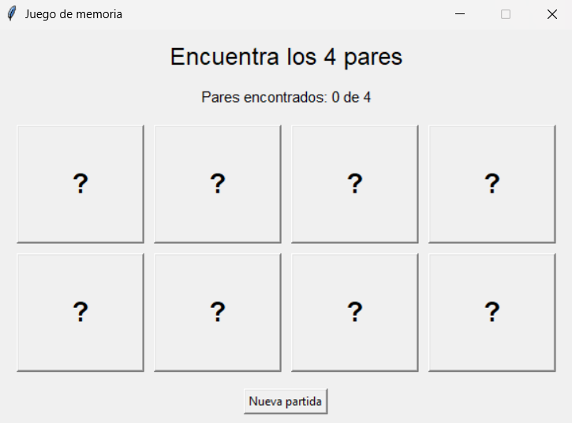

# Juego de Memoria - Python

## 1. Descripción del proyecto

Este proyecto consiste en el desarrollo de un juego de memoria utilizando Python y la biblioteca Tkinter para la creación de la interfaz gráfica.

Para su implementación se utiliza OpenAI Codex, mediante instrucciones estructuradas que permiten generar el código y realizar mejoras progresivas.

## 2. Objetivo del proyecto

Desarrollar un juego de memoria interactivo en el que el usuario debe encontrar cuatro pares de cartas iguales.

El juego consiste en seleccionar dos cartas por turno para descubrir su contenido. Si ambas coinciden, desaparecen del tablero; de lo contrario, vuelven a ocultarse. El jugador gana cuando encuentra los cuatro pares.

El desarrollo se realizará por etapas, comenzando con una versión básica funcional y posteriormente incorporando mejoras.

## 3. Primera iteración - Versión 1.0

### 3.1. Prompt utilizado

*# Contexto
Eres un asistente experto en desarrollo de software utilizando Python. Tu objetivo es desarrollar aplicaciones sencillas, funcionales y fáciles de comprender.

# Instrucción
Necesito que desarrolles una primera versión de un juego de memoria utilizando Python.

El juego debe funcionar de la siguiente manera:

1. Al iniciar, se mostrarán 8 cartas distribuidas en una cuadrícula de 4 columnas y 2 filas, formando 4 pares.
2. Todas las cartas estarán inicialmente boca abajo.
3. El jugador podrá seleccionar dos cartas por turno para descubrir su contenido.
4. Si ambas cartas coinciden, desaparecerán del tablero.
5. Si las cartas no coinciden, permanecerán visibles durante 1 segundo y luego volverán a estar boca abajo.
6. Las cartas deben distribuirse aleatoriamente cada vez que comience una partida.
7. Cuando el jugador encuentre los 4 pares, se mostrará un mensaje indicando que ha ganado.
8. El juego debe incluir un botón para iniciar una nueva partida.

# Formato de salida
- Utiliza Python como lenguaje de programación.
- Desarrolla una interfaz gráfica sencilla utilizando Tkinter.
- Guarda todos los archivos del proyecto en la carpeta `C:\Game`.
- El archivo principal debe llamarse `main.py`.
- Incluye las instrucciones necesarias para ejecutar el juego.

### 3.2. ¿Qué se solicitó a la IA?

Se solicitó a Codex desarrollar una primera versión del juego de memoria utilizando Python, estableciendo como funcionalidad principal la identificación de cuatro pares de cartas.

La intención de este primer prompt fue obtener una estructura básica del juego sin incorporar imágenes personalizadas ni características adicionales.

### 3.3. Resultado obtenido

Como resultado de la primera interacción con Codex, se obtuvo una aplicación con interfaz gráfica desarrollada utilizando Tkinter.

La interfaz generada presenta las siguientes características:

- Un tablero compuesto por ocho cartas distribuidas en dos filas y cuatro columnas.
- Cartas representadas inicialmente mediante signos de interrogación.
- Un contador que muestra la cantidad de pares encontrados.
- Un botón para iniciar una nueva partida.
- Una estructura visual sencilla que servirá como base para futuras mejoras.

### 3.4. Evidencia de la primera versión

**Figura 1.** Interfaz inicial del juego de memoria generada mediante Codex.

Esta primera versión establece la base del proyecto. En las siguientes iteraciones se buscará mejorar su presentación visual y agregar nuevas funcionalidades mediante prompts adicionales.