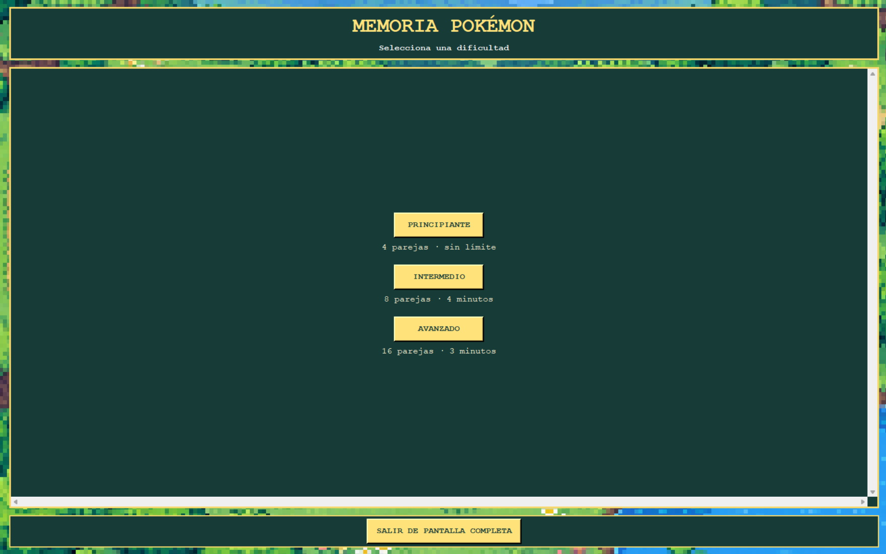
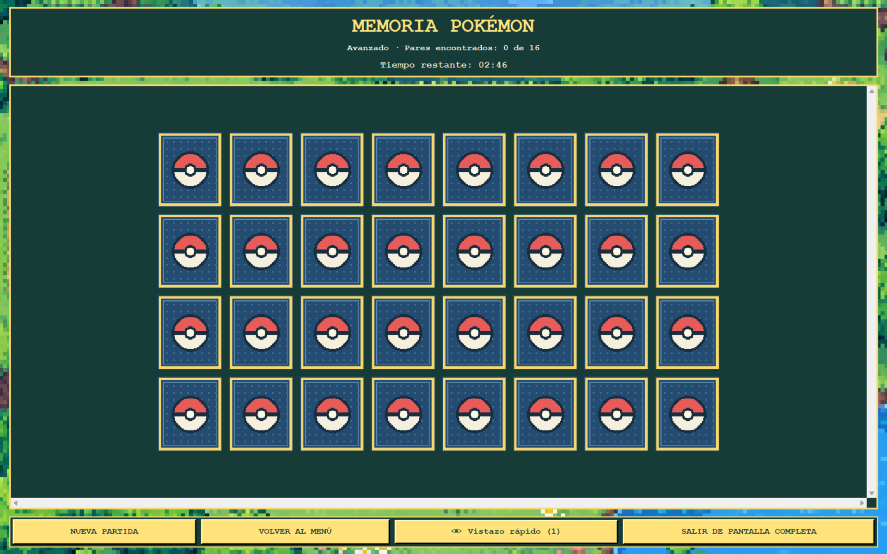
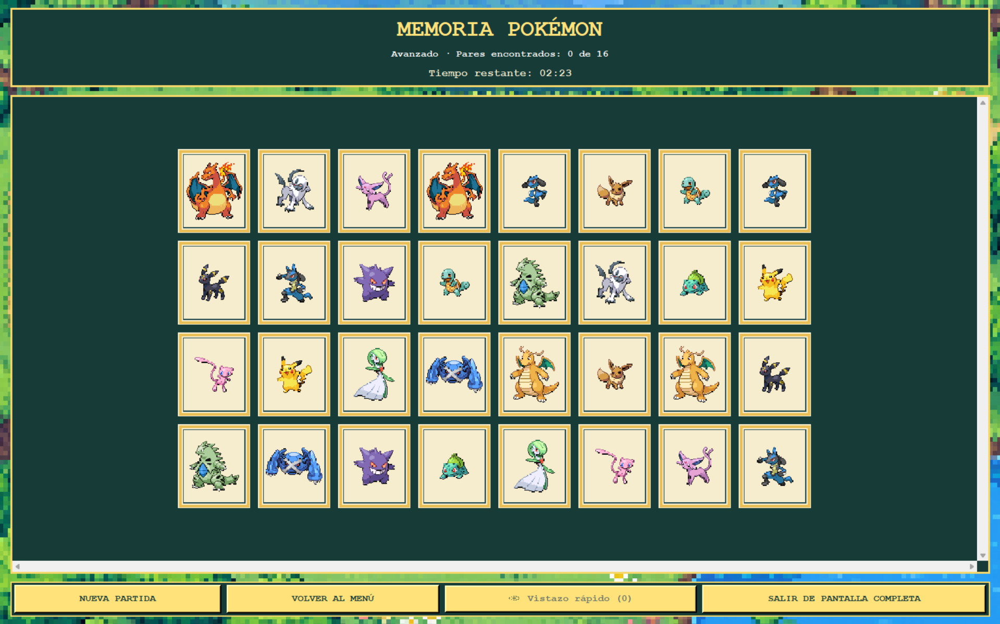
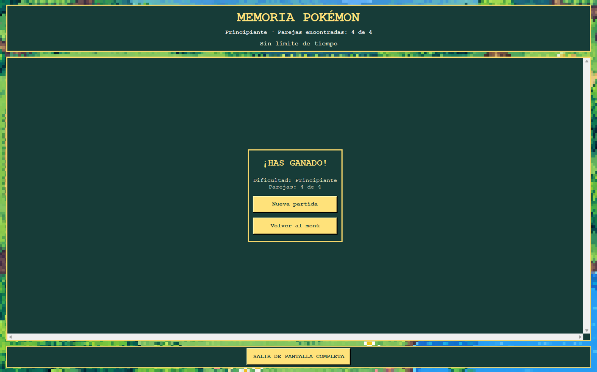
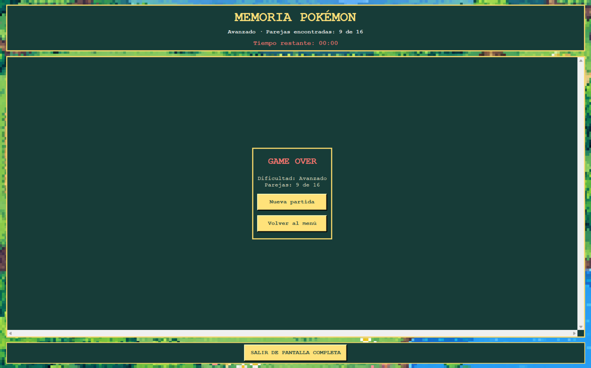

## . Cuarta iteración - Versión 4.0

### Primer prompt utilizado - Temporizador y resultados

**Contexto:**

Tenemos la versión 3.0 de Memoria Pokémon desarrollada en Python y Tkinter, ubicada en `C:\Game`, con `main.py` como archivo principal.

El juego tiene tres dificultades, sprites pixel art, pantalla completa, contador de parejas y menú principal.

Quiero comenzar el desarrollo de la versión 4.0 sin alterar las funcionalidades existentes.

**Instrucción:**

Implementa las siguientes mejoras:

**1. Temporizador según dificultad**

- Principiante: 4 parejas, sin límite de tiempo.
- Intermedio: 8 parejas, 4 minutos.
- Avanzado: 16 parejas, 3 minutos.

En Principiante muestra "Sin límite de tiempo".

En los demás niveles, muestra una cuenta regresiva en formato MM:SS, que comience al iniciar la partida.

Cuando queden 15 segundos o menos, cambia el color del temporizador.

Al llegar a cero, finaliza la partida y muestra Game Over.

El temporizador debe detenerse al ganar, reiniciarse con Nueva partida y cancelarse al volver al menú. No debe reiniciarse al cambiar a pantalla completa.

**2. Panel de victoria**

Actualmente la victoria aparece en una ventana independiente.

Reemplázala por un panel integrado en la ventana principal que muestre:

- Mensaje "¡HAS GANADO!".
- Dificultad completada.
- Parejas encontradas.
- Tiempo restante, cuando corresponda.
- Botón Nueva partida.
- Botón Volver al menú.

**3. Panel de Game Over**

Cuando se agote el tiempo, muestra un panel integrado que incluya:

- Mensaje "GAME OVER".
- Dificultad seleccionada.
- Parejas encontradas.
- Botón Nueva partida.
- Botón Volver al menú.

El nivel Principiante nunca debe perder por tiempo.

**4. Menú e interfaz**

Actualiza los nombres y la información de los niveles:

- Principiante: 4 parejas, sin límite.
- Intermedio: 8 parejas, 4 minutos.
- Avanzado: 16 parejas, 3 minutos.

Mantén los sprites, el fondo, los bordes dorados y la estética pixel art actual.

Organiza el tablero y los controles para que sigan siendo visibles en pantalla completa y en ventanas más pequeñas.

**Restricciones:**

- Modifica el proyecto existente; no lo desarrolles desde cero.
- Conserva todas las reglas y funcionalidades de la V3.0.
- No implementes todavía las ayudas.
- No modifiques el README ni las evidencias.
- No abras ventanas independientes para victoria o derrota.
- Cancela correctamente los eventos `after()` al reiniciar, ganar, perder o regresar al menú.
- Evita que una partida anterior afecte a una nueva.
- No utilices servicios externos durante la ejecución.

**Validación solicitada:**

Comprueba los tres niveles, la cuenta regresiva, la victoria, el Game Over, el reinicio, el regreso al menú y la pantalla completa.

Ejecuta las pruebas automatizables e indica cuáles requieren comprobación manual.

Corrige los errores encontrados antes de finalizar.

### ¿Qué se solicitó a la IA en el primer prompt?

Se solicitó a Codex incorporar un sistema de temporizador adaptado a los niveles de dificultad y modificar la presentación de los resultados del juego.

El objetivo principal fue agregar presión de tiempo a los niveles Intermedio y Avanzado, conservando el nivel Principiante como una modalidad sin límite de tiempo.

También se solicitó reemplazar las ventanas independientes de victoria por paneles integrados en la interfaz principal e incorporar una pantalla de Game Over cuando se agotara el tiempo.

### Resultado obtenido del primer prompt

Como resultado de esta interacción, se incorporaron las siguientes funcionalidades:

- Temporizador de cuatro minutos en Intermedio.
- Temporizador de tres minutos en Avanzado.
- Nivel Principiante sin límite de tiempo.
- Advertencia visual durante los últimos 15 segundos.
- Panel de victoria integrado en la ventana principal.
- Panel de Game Over al agotarse el tiempo.
- Actualización del menú principal con las características de cada dificultad.
- Reinicio del temporizador al comenzar una nueva partida.

Después de implementar estos cambios, se realizaron pruebas de funcionamiento y se confirmó que las nuevas funcionalidades operaban correctamente antes de continuar con el siguiente prompt.

### Segundo prompt utilizado - Sistema de ayudas

**Contexto:**

Continuamos desarrollando la versión 4.0 de Memoria Pokémon en `C:\Game`, utilizando Python y Tkinter.

El juego ya dispone de niveles de dificultad, temporizador, Game Over y panel de victoria integrado.

Necesito agregar un sistema de ayudas inspirado en la función Sneak Peek del juego Purble Pairs.

**Instrucción:**

**1. Botón de ayuda**

Agrega un botón denominado "Vistazo rápido", acompañado de un icono de ojo.

Al presionarlo:

1. Revela simultáneamente todas las cartas que todavía no hayan sido emparejadas.
2. Manténlas visibles durante 2 segundos.
3. Vuelve a ocultarlas automáticamente.
4. Bloquea la selección de cartas mientras la ayuda está activa.
5. Conserva las parejas encontradas.
6. Consume una ayuda disponible.

**2. Ayudas por dificultad**

- Principiante: 3 ayudas.
- Intermedio: 2 ayudas.
- Avanzado: 1 ayuda.

Muestra las ayudas restantes junto al botón.

Cuando se agoten, desactiva el botón.

**3. Integración con el temporizador**

- El tiempo debe continuar avanzando mientras se utiliza una ayuda.
- Si el tiempo llega a cero durante una ayuda, debe aparecer Game Over inmediatamente.
- No permitas activar ayudas después de ganar o perder.
- No permitas activar dos ayudas simultáneamente.
- Si existen cartas descubiertas o una animación pendiente, desactiva temporalmente la ayuda hasta que termine esa acción.

**4. Reinicio y navegación**

Al seleccionar Nueva partida, restablece la cantidad de ayudas según la dificultad.

Al regresar al menú, cancela cualquier ayuda pendiente.

Evita que eventos anteriores afecten partidas nuevas.

**Restricciones:**

- Conserva todas las funcionalidades implementadas.
- No modifiques el diseño general, los sprites ni el fondo.
- No agregues penalizaciones de tiempo por usar ayudas.
- No implementes sistemas de puntuación adicionales.
- No modifiques el README ni las evidencias.
- No utilices servicios externos durante la ejecución.

**Validación solicitada:**

Comprueba que las ayudas funcionen en los tres niveles, se consuman correctamente, revelen las cartas durante 2 segundos y no interfieran con el temporizador.

Verifica el reinicio, el regreso al menú y el agotamiento del tiempo durante una ayuda.

Corrige los errores encontrados y explica cuáles pruebas se realizaron.

### ¿Qué se solicitó a la IA en el segundo prompt?

Se solicitó a Codex incorporar un sistema de ayudas inspirado en la mecánica Sneak Peek de Purble Pairs.

La finalidad fue permitir que el jugador pudiera observar temporalmente las cartas restantes para recordar sus posiciones.

Para mantener el equilibrio entre dificultades, se estableció una cantidad limitada de ayudas según el nivel seleccionado.

También se solicitó integrar esta funcionalidad con el temporizador y evitar conflictos entre los eventos del juego.

### Resultado obtenido del segundo prompt

Como resultado de esta segunda interacción, se implementó el sistema de ayudas denominado "Vistazo rápido".

Entre sus características se encuentran:

- Botón de ayuda identificado mediante un icono de ojo.
- Revelación temporal de las cartas restantes durante dos segundos.
- Bloqueo de interacción mientras la ayuda está activa.
- Cantidad limitada de ayudas según la dificultad.
- Desactivación del botón al agotar las ayudas.
- Integración con el temporizador.
- Restablecimiento de las ayudas al iniciar una nueva partida.

Esta mejora complementó las funcionalidades implementadas anteriormente y permitió finalizar el desarrollo de la versión 4.0.

### Configuración final del juego

| Dificultad | Parejas | Cartas | Tiempo | Ayudas |
|---|---:|---:|---|---:|
| Principiante | 4 | 8 | Sin límite | 3 |
| Intermedio | 8 | 16 | 4 minutos | 2 |
| Avanzado | 16 | 32 | 3 minutos | 1 |

### Evidencia de la cuarta versión

**Figura 6.** Menú principal con las características de las tres dificultades.

**Figura 7.** Tablero con temporizador y contador de parejas.

**Figura 8.** Función Vistazo rápido mostrando temporalmente las cartas.

**Figura 9.** Panel de victoria integrado en la ventana principal.

**Figura 10.** Pantalla de derrota cuando se agota el tiempo disponible.

### Validación y pruebas realizadas

El desarrollo de la versión 4.0 se dividió en dos etapas para facilitar la implementación y validación de las nuevas funcionalidades.

Después del primer prompt se realizaron pruebas del temporizador, los paneles de victoria y derrota y la navegación entre pantallas. Los resultados fueron satisfactorios.

Posteriormente, después del segundo prompt, se realizaron pruebas del sistema de ayudas y se confirmó su funcionamiento correcto.

Las pruebas permitieron comprobar el comportamiento general de las funcionalidades incorporadas y la conservación de las características desarrolladas en las versiones anteriores.

La validación progresiva permitió detectar posibles problemas antes de incorporar nuevas funcionalidades, reduciendo la complejidad del proceso de desarrollo.
