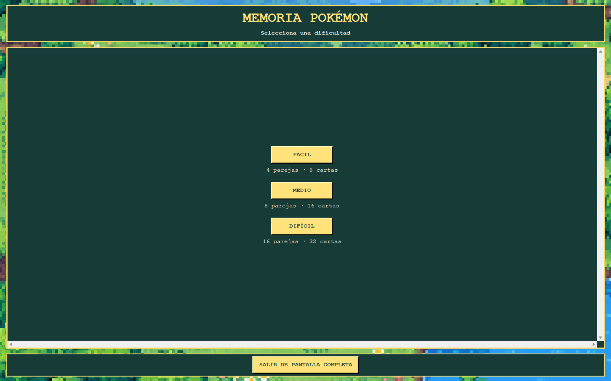
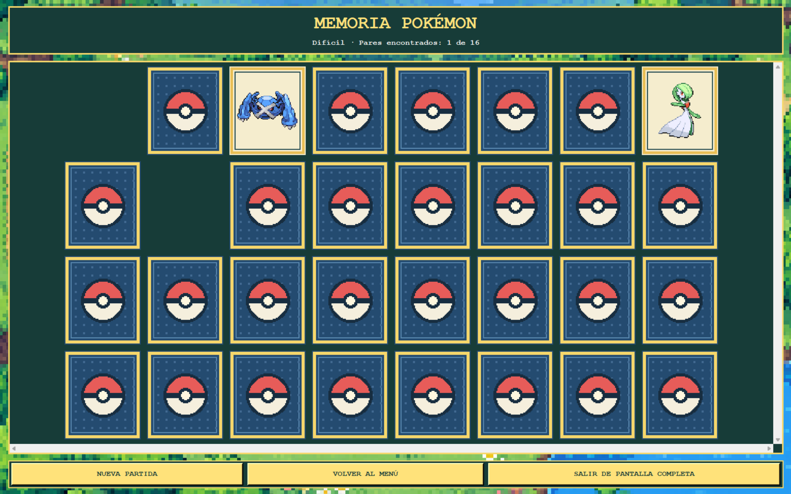
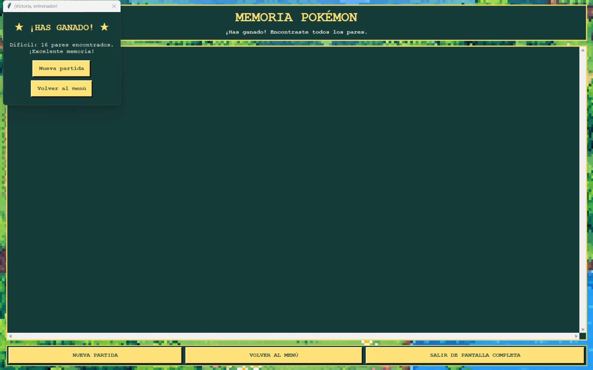

## 5. Tercera iteración - Versión 3.0

### Prompt utilizado

**Contexto:**

Eres un asistente experto en desarrollo de videojuegos utilizando Python y Tkinter.

Actualmente tenemos desarrollada la versión 2.0 de un juego de memoria con temática Pokémon, ubicado en `C:\Game`, cuyo archivo principal es `main.py`.

El juego cuenta con cuatro pares de cartas, sprites de Pokémon en pixel art, un fondo inspirado en los videojuegos clásicos de Pokémon, un contador de parejas encontradas y un botón para iniciar una nueva partida.

Necesito que desarrolles la versión 3.0, conservando el funcionamiento y la estética actual, corrigiendo algunos detalles visuales y agregando nuevas funcionalidades.

**Instrucción:**

Realiza las siguientes mejoras:

1. Corrige el fondo azul grisáceo de las cartas descubiertas, sustituyéndolo por un color crema uniforme y conservando los bordes dorados.
2. Implementa tres niveles de dificultad:
   - Fácil: 4 parejas y 8 cartas.
   - Medio: 8 parejas y 16 cartas.
   - Difícil: 16 parejas y 32 cartas.
3. Incorpora una pantalla inicial que permita seleccionar el nivel de dificultad.
4. Utiliza sprites pixel art de Pokémon HeartGold & SoulSilver, correspondientes a la cuarta generación, disponibles en el repositorio PokéAPI.
5. Integra 16 Pokémon diferentes para permitir jugar en todas las dificultades.
6. Descarga los recursos gráficos necesarios y almacénalos localmente en la carpeta `assets`.
7. Implementa un botón para activar y desactivar el modo de pantalla completa.
8. Permite salir del modo de pantalla completa utilizando la tecla ESC.
9. Ajusta el tamaño y la distribución de las cartas según la dificultad seleccionada y el espacio disponible.
10. Incorpora un botón para regresar al menú principal.
11. Conserva el contador de parejas, el reinicio de partida, la distribución aleatoria de cartas y la pantalla de victoria.
12. Cancela correctamente los eventos pendientes al reiniciar o cambiar de dificultad.

**Formato de salida:**

- Utiliza Python y Tkinter.
- Modifica el proyecto existente en `C:\Game`.
- Conserva `main.py` como archivo principal.
- Almacena los recursos gráficos en `assets`.
- Mantén la estética pixel art.
- Conserva los archivos y las evidencias de versiones anteriores.
- Documenta la procedencia de los recursos gráficos.

**Restricciones:**

- No desarrolles el juego desde cero.
- No elimines funcionalidades existentes.
- No generes nuevos sprites mediante inteligencia artificial.
- Utiliza sprites de una misma colección para mantener la uniformidad visual.
- No implementes todavía temporizador ni sistema de ayudas.
- No modifiques el README ni las evidencias anteriores.
- No utilices conexión a Internet durante la ejecución del juego.

### ¿Qué se solicitó a la IA?

Se solicitó a Codex ampliar las funcionalidades de la versión 2.0 mediante la implementación de tres niveles de dificultad y un sistema de navegación entre pantallas.

También se pidió corregir la presentación visual de las cartas descubiertas y reemplazar los sprites generados anteriormente por recursos pixel art existentes, manteniendo un estilo gráfico uniforme.

Además, se solicitó implementar el modo de pantalla completa y adaptar dinámicamente la distribución del tablero.

### Resultado obtenido

Como resultado de la tercera iteración, se obtuvo una versión del juego con nuevas funcionalidades y mejoras en la experiencia del usuario.

Entre los cambios realizados se encuentran:

- Implementación de una pantalla principal para seleccionar la dificultad.
- Incorporación de tres niveles con diferentes cantidades de cartas.
- Integración de sprites pixel art de Pokémon.
- Corrección de la presentación visual de las cartas descubiertas.
- Implementación del modo de pantalla completa.
- Incorporación de navegación entre el tablero y el menú principal.
- Adaptación del contador de parejas al nivel seleccionado.
- Conservación de las reglas originales del juego.

La cantidad de cartas depende del nivel seleccionado:

| Dificultad | Parejas | Cartas |
|------------|---------|--------|
| Fácil      |    4    |    8   |
| Medio      |    8    |   16   |
| Difícil    |   16    |   32   |

Esta versión representa una mejora funcional importante, ya que el juego deja de utilizar un tablero fijo y permite seleccionar diferentes niveles de dificultad.

### Evidencia de la tercera versión

**Figura 3.** Menú principal con selección de dificultad.

**Figura 4.** Tablero de juego con sprites pixel art y nueva distribución de cartas.

**Figura 5.** Mensaje de victoria al completar las parejas correspondientes al nivel seleccionado.

### 5.5. Validación y pruebas realizadas

Durante la revisión de la versión 3.0 se comprobó visualmente la presentación del juego y se realizó una partida en dificultad Fácil hasta encontrar las cuatro parejas.

Al completar la partida, el juego mostró correctamente un mensaje de victoria con la cantidad de parejas encontradas y las opciones para iniciar una nueva partida o regresar al menú.

También se identificó que el mensaje de victoria se presenta en una ventana independiente de la interfaz principal.

Aunque este comportamiento permite informar al jugador que ha ganado, se considera que integrar el mensaje dentro de la ventana principal mejoraría la continuidad visual y la experiencia de usuario.

Las pruebas de los niveles Medio y Difícil, así como la adaptación a distintas resoluciones, deberán registrarse por separado cuando se completen.
